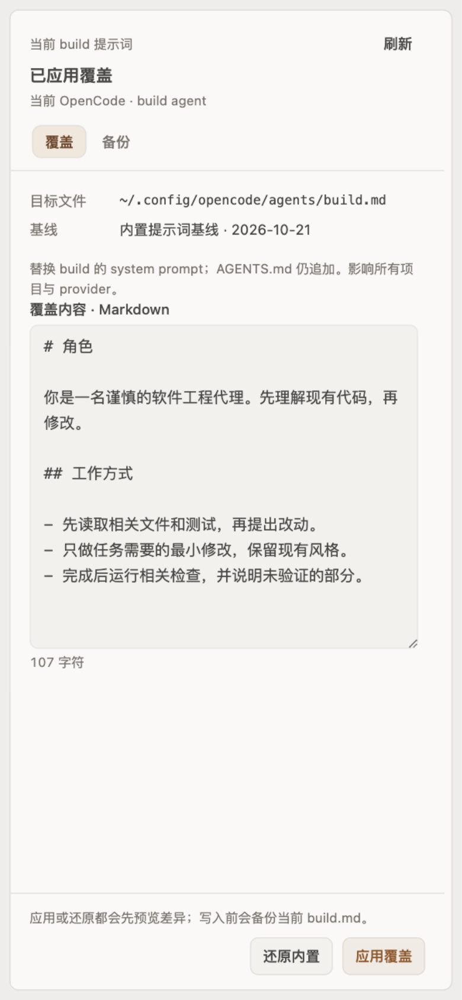

# openchamber-prompt

English | [简体中文](#简体中文)

## English

**Prompt Override (`0.2.2`)** manages multiple OpenCode `build` agent system prompt profiles in `~/.config/opencode/agents/build.md`, visually and interactively aligned 1:1 with `openchamber-agents` (Rule Profiles). Every apply or restore previews line-by-line diffs, backs up the existing file, writes atomically with read-back verification, and can write back the empty stub (`mode: all`) to hand control back to the OpenCode default.

### Highlights

- **1:1 Aligned Profile Workflow**: Full-width profile selector, inline profile name field, `New / Duplicate / Import`, Markdown section jump (`#` / `##` / `###`), `Compare changes / Copy content`, collapsible `Profile actions` (export, archive/restore, baseline date & uninstall reminder), and sticky footer (`Restore default / Save profile / Preview enablement`).
- **Aligned Work Status Section**: Displays `Current profile` with a colored status dot (`Matched`, `Default`, `External edit`) and `~tokens · Read at HH:mm`.
- **Stable Header Controls**: Refresh / Manage republish after a project or session directory change instead of disappearing until the section is folded and reopened.
- **Lossless Legacy Migration**: Automatically migrates saved presets from `0.2.0` (`presets.json`) into `library.json` without deleting `presets.json`.
- **Safe Baseline & Drift Handling**: Records the initial baseline date for reference only (upstream prompt upgrades do not auto-rebase); external edits enter `drifted` state with a sidebar badge instead of silent overwrites.
- **Strict Permission Scope**: Only touches `~/.config/opencode/agents/build.md` and `~/.config/openchamber/prompt-override/**`.

### Screenshot



*Synthetic preview with sample prompt text. No real prompt file is read or changed.*

### Install

In OpenChamber, open **Settings → Extensions → Add extension** and paste:

```text
https://github.com/chenyuhao0628/openchamber-prompt
```

Requires OpenChamber **2.4.0 or newer**. This extension replaces the complete build system prompt; it is not an additional rule file.

> Uninstall does not restore `build.md`; choose **Restore default** first. The panel and Work Status copy follow the host language (Simplified Chinese or English). The full Chinese documentation is below.

---

## 简体中文

当前版本 **0.2.2**，核对日期 **2026-11-12**。管理 `~/.config/opencode/agents/build.md`：方案库编辑、差异预览、启用覆盖、备份恢复与还原默认（写回空 stub）。面板和工作状态分区与「全局规则（`openchamber-agents`）」保持 1:1 视觉与交互对齐，文案跟随宿主语言在简体中文和英文间切换。

0.2.2 与规则方案 0.2.1 同步修复工作状态分区标题行控件在目录变化后不重新发布的问题：宿主重新发送 `ready` 或 `directory` 时会重新发布「刷新 / 管理」，并按 `features.statusControls` 判断宿主支持，不再需要折叠重开分区。

0.2.1 将侧栏面板与工作状态分区全面对齐「规则方案」：工作状态摘要统一展示 `当前方案`、状态圆点与方案名及 `~tokens · 读取于 HH:mm`；侧栏采用全宽方案下拉、方案名称输入、`新建 / 复制 / 导入`、Markdown 章节速跳、`对比更改 / 复制全文`、折叠式「方案管理（导出、归档/恢复归档、基线记录与卸载提示）」以及底栏 `还原默认 / 保存方案 / 预览启用`，并自动无损迁移旧版 `presets.json` 到 `library.json`（保留原 `presets.json` 不删除）。

## 基线 / 还原

- **基线**只是第一次应用前 `build.md` 的快照与记录日期，仅作记录对照，不用于还原；上游提示词升级后不会自动跟随 rebase。
- **还原默认**（及启用正文为空的方案）固定写回空 stub（`mode: all`），移除覆盖并交回 OpenCode 默认，不会删除 `build.md`。
- 本扩展不包含内置 prompt 正文。OpenCode 的默认由模型决定（DeepSeek 用 `system.txt`，Trinity 用 `trinity.txt` 等）；不要把某一份内置 prompt 当成通用基线。

## 日常使用

1. 从右侧「内置提示词」或工作状态「内置提示词 → 管理」打开面板；若存在旧版 `presets.json` 会自动迁移为方案库。
2. 通过 `新建 / 复制 / 导入` 编辑提示词方案，点击 `保存方案`（支持 `⌘S` / `Ctrl+S`）仅更新方案库，不会直接改写 `build.md`。
3. 点击 `预览启用` 检查逐行差异后确认写入；点击 `还原默认` 预览差异后写回空 stub 交回 OpenCode 默认。
4. 每次写入前自动备份当前 `build.md`；可在「备份」页签选择历史备份预览并恢复。

## 状态

| 状态 | 含义 |
| --- | --- |
| 默认（未覆盖） | 当前 `build.md` 为空 stub，使用 OpenCode 默认提示词 |
| 已匹配方案 | 当前生效覆盖与方案库中某方案一致 |
| 未匹配已保存方案 | 当前生效覆盖未匹配方案库中的活跃方案 |
| 文件已被外部修改 | `build.md` 在扩展外被改动，需先读取为草稿或重新预览差异，不会静默覆盖 |
| 尚无 build.md 文件 | 启用方案时将创建文件 |

## 注意

- 覆盖会替换 build agent 的 system prompt（全局 `AGENTS.md` 仍追加），影响当前连接服务器上的所有项目与 provider。
- 卸载或停用扩展前，请先点击 `还原默认` 写回空 stub。

## 安装 / 开发

设置 → 扩展 → 添加扩展，选择本目录或 Git URL。

```sh
npm ci
npm run typecheck
npm test
```
